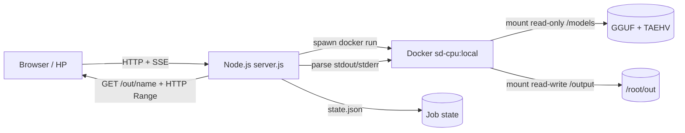

# sd-wan-ui

UI web ringan untuk menjalankan inference **Wan 2.1 T2V 1.3B Q4_K_M** lewat `stable-diffusion.cpp` di Docker, dengan progres realtime via Server-Sent Events (SSE) dan gallery hasil.

## Ringkasan

- Backend: **Node.js built-in modules only** (`http`, `fs`, `path`, `child_process`) — tidak ada dependency npm.
- Inference: `sd-cli` dari `stable-diffusion.cpp` release `master-1106-532d2c1`, dikemas sebagai image Docker CPU `sd-cpu:local`.
- Target awal: server tanpa GPU, 2 core CPU, RAM 7.8 GB, disk awal 4.4 GB.
- Mode: `-M vid_gen`. `frames=1` menghasilkan PNG; `frames>1` menghasilkan video.
- UI: vanilla HTML/CSS/JS, responsive Apple-like, dilengkapi filter Semua/Gambar/Video.

## Arsitektur



### Alur request

1. Browser membuka `/` dan langsung membuka `/api/stream`.
2. Server mengirim event `hello` berisi `job` terakhir dan daftar `files`.
3. Browser POST ke `/api/generate` dengan `prompt`, `frames`, `steps`, `width`, `height`, `cfg`, dan `negative`.
4. Server memvalidasi input, lalu membuat satu job dan menjalankan Docker:
   - `-M vid_gen`
   - `--diffusion-model /models/wan2.1_t2v_1.3b-q4_k_m.gguf`
   - `--t5xxl /models/umt5-xxl-encoder-Q3_K_S.gguf`
   - `--taesd /models/taew2_1.safetensors`
   - `-o /output/<nama>`
5. Stdout/stderr `sd-cli` diparse untuk:
   - progress `current/total/percent`
   - log penting `[I]`, `[W]`, `[E]`
   - path hasil dari baris `save result ...`
6. Server menyebarkan event SSE: `status`, `progress`, `log`, `files`, `file`.
7. File watcher 1 detik mendeteksi file baru di `/root/out`, lalu gallery di-refresh.
8. Video dilayani lewat `/out/<nama>` dengan dukungan `HTTP 206 Partial Content` sehingga bisa di-seek di browser/HP.

### Komponen

| File | Fungsi |
| --- | --- |
| `server.js` | HTTP router, SSE hub, job manager, auth opsional, state persistence, video Range serving |
| `index.html` | UI single-file: form generate, status/progress, log, gallery, filter media |
| `Dockerfile` | Image CPU dari binary resmi `stable-diffusion.cpp` Ubuntu 26.04 x86_64 |
| `scripts/download-models.sh` | Download model ke `MODEL_DIR` |
| `scripts/build-image.sh` | Build image `sd-cpu:local` |
| `scripts/infer.sh` | Inference manual tanpa UI |
| `scripts/start-ui.sh` | Menjalankan UI dengan `.env` opsional |
| `.env.example` | Contoh konfigurasi lingkungan |
| `state.json` | Disimpan otomatis saat runtime; tidak ikut di-commit |

## Detail model

Pipeline Wan T2V memakai tiga model yang dipanggil berurutan oleh `sd-cli`:

| Tahap | File | Ukuran | Fungsi | Kenapa dipilih |
| --- | --- | --- | --- | --- |
| Text conditioning | `umt5-xxl-encoder-Q3_K_S.gguf` | 2.7 GB | Mengubah prompt positif dan negatif jadi embedding teks | UMT5-XXL adalah encoder teks yang diharapkan Wan. Q8 tidak muat di disk/RAM host uji, jadi dipakai Q3_K_S yang jauh lebih kecil dengan kualitas masih memadai untuk prompt pendek |
| Diffusion / denoising | `wan2.1_t2v_1.3b-q4_k_m.gguf` | 987 MB | Model Wan 2.1 T2V 1.3B yang membuat latent video dari embedding teks | Sesuai permintaan. Q4_K_M adalah titik seimbang antara ukuran dan akurasi, serta muat di RAM 7.8 GB |
| VAE decode | `taew2_1.safetensors` | 22 MB | Mendekode latent video menjadi frame akhir | VAE Wan penuh jauh lebih besar. TAEHV membuat total model hanya ~3.7 GB dan decoding jauh lebih ringan di CPU |

Total file model di disk: **~3.7 GB**. `sd-cli` juga melaporkan total parameter memori ~3.7 GB ditambah compute buffer saat conditioning dan decoding.

Tahap internal yang terlihat di log runtime:

1. `load_backend` memilih backend `ggml-cpu` karena auto-fit mendeteksi `no GPU devices`.
2. `get_learned_condition` menjalankan UMT5 untuk prompt positif dan negatif.
3. `generate_video` menjalankan sampling FLOW/Euler pada diffusion model selama `--steps` langkah.
4. `decode_video_outputs` memanggil TAEHV mengubah latent `40x32x3x16` menjadi `320x256x9x3`.
5. `save result` menulis hasil ke `/output`, lalu Node menyalin daftar file ke UI.

Sumber model:

- `https://huggingface.co/calcuis/wan-1.3b-gguf/resolve/main/wan2.1_t2v_1.3b-q4_k_m.gguf`
- `https://huggingface.co/city96/umt5-xxl-encoder-gguf/resolve/main/umt5-xxl-encoder-Q3_K_S.gguf`
- `https://github.com/madebyollin/taehv/raw/refs/heads/main/safetensors/taew2_1.safetensors`

## Fungsi `stable-diffusion.cpp` yang dipakai

Semua argumen dirakit di `startJob()` (`server.js:223`). Berikut arti dan alasannya:

| Argumen | Fungsi | Kenapa |
| --- | --- | --- |
| `-M vid_gen` | Mengaktifkan mode video generation Wan | Tanpa ini, `--video-frames` saja tidak cukup untuk menghasilkan video |
| `--diffusion-model ...q4_k_m.gguf` | Memuat checkpoint diffusion utama | Mesin denoising Wan 1.3B; Q4_K_M sesuai target ukuran/akurasi |
| `--t5xxl ...Q3_K_S.gguf` | Memuat text encoder UMT5-XXL | Wan memerlukan conditioning teks; Q3_K_S dipilih agar muat resource |
| `--taesd ...taew2_1.safetensors` | Memakai TAEHV sebagai VAE pengganti | Lebih ringan dari VAE penuh, cukup untuk preview video |
| `-p` / `-n` | Prompt positif dan negatif | Diolah oleh T5 sebelum masuk diffusion model |
| `--cfg-scale 6.0` | Mengontrol seberapa kuat prompt memandu sampling | 6.0 cukup mengarah tanpa efek berlebih pada Wan CPU |
| `--sampling-method euler` | Solver sampling FLOW | Cukup cepat dan stabil di CPU dibanding solver yang lebih kompleks |
| `--flow-shift 3.0` | Menyesuaikan jadwal noise FLOW | Nilai umum untuk Wan dan aman di step rendah |
| `--steps` | Jumlah langkah denoising | 4 untuk smoke test cepat, 10 untuk kualitas uji |
| `-W` / `-H` | Resolusi frame | 320x256 dipakai saat uji video agar 2 core CPU tidak kewalahan; server memaksa kelipatan 16 |
| `--video-frames` | Jumlah frame yang dibuat | `1` menghasilkan PNG, `>1` menghasilkan video |
| `-o /output/<nama>.avi` | Path output di dalam container | `/root/out` di-mount ke `/output`. Harus `.avi`/`.webm`/`.webp`; `.mp4` akan ditambahi `.avi` oleh `sd-cli` |
| `-v` | Logging verbose | Server mem-parsing progres dan path hasil dari baris log verbose |

Backend dipilih otomatis sebagai CPU. Tidak ada flag CUDA/Vulkan karena host tidak memiliki GPU dan image resmi CPU yang dipakai adalah build Ubuntu x86_64 biasa.

Untuk video, server meminta `.avi` ke `sd-cli`, lalu setelah container selesai menjalankan `ffmpeg` untuk menghasilkan `.mp4` H.264/yuv420p yang bisa diputar browser. AVI asli dihapus kecuali `KEEP_AVI=1`. Jika `ffmpeg` tidak tersedia, AVI tetap disimpan dan UI menampilkan warning.

## API

| Method | Endpoint | Keterangan |
| --- | --- | --- |
| `GET` | `/` | UI |
| `GET` | `/api/health` | Health check ringan, tidak terkena auth |
| `GET` | `/api/status` | Job terakhir + daftar file |
| `GET` | `/api/files` | Daftar file hasil |
| `GET` | `/api/stream` | SSE realtime |
| `POST` | `/api/generate` | Memulai inference |
| `GET` | `/out/<nama>` | Mengirim PNG/MP4/WebM/AVI, support Range |

Contoh generate video pendek:

```bash
curl -X POST http://127.0.0.1:3001/api/generate \
  -H 'Content-Type: application/json' \
  -d '{
    "prompt": "a lovely cat walking in neon rain, cinematic lighting",
    "frames": 9,
    "steps": 4,
    "width": 320,
    "height": 256,
    "cfg": 6
  }'
```

Event SSE:

- `hello` — state awal
- `status` — perubahan status job
- `progress` — progres sampling
- `log` — baris log terpilih
- `files` — daftar file terbaru
- `file` — notifikasi file baru

## Konfigurasi

Salin `.env.example` menjadi `.env`, lalu sesuaikan:

| Variabel | Default | Keterangan |
| --- | --- | --- |
| `HOST` | `0.0.0.0` | Bind address UI |
| `PORT` | `3001` | Port UI |
| `UI_TOKEN` | kosong | Jika diisi, aktifkan Basic Auth dengan username `sd` |
| `OUT_DIR` | `/root/out` | Direktori hasil generate |
| `MODEL_DIR` | `/root/models/wan` | Direktori model GGUF/TAEHV |
| `SD_IMAGE` | `sd-cpu:local` | Nama image Docker inference |
| `FFMPEG_BIN` | `ffmpeg` | Path binary ffmpeg untuk konversi AVI → MP4 |
| `KEEP_AVI` | `0` | Set `1` untuk menyimpan AVI asli setelah konversi |

Jika `UI_TOKEN` kosong, UI terbuka tanpa auth. Untuk deployment publik, disarankan mengisinya dan menaruh reverse proxy dengan TLS di depan.

## Deployment

### Development / akses langsung

```bash
./scripts/download-models.sh
./scripts/build-image.sh
cp .env.example .env
./scripts/start-ui.sh
```

Buka `http://<host>:3001`. Mode ini cocok untuk pengujian lokal. Jika UI diekspos langsung ke internet, **wajib** isi `UI_TOKEN` karena tanpa reverse proxy tidak ada TLS.

Inference manual tanpa UI:

```bash
FRAMES=9 STEPS=4 WIDTH=320 HEIGHT=256 ./scripts/infer.sh "a lovely cat walking in neon rain"
```

### Production dengan systemd + reverse proxy TLS

1. Isi `/root/sd-ui/.env`:

```env
HOST=127.0.0.1
PORT=3001
UI_TOKEN=ganti-dengan-token-kuat
OUT_DIR=/root/out
MODEL_DIR=/root/models/wan
SD_IMAGE=sd-cpu:local
FFMPEG_BIN=ffmpeg
KEEP_AVI=0
```

`HOST=127.0.0.1` disarankan bila reverse proxy berada di host yang sama. Jika tetap memakai `0.0.0.0`, batasi akses lewat firewall dan aktifkan `UI_TOKEN`.

2. Buat `/etc/systemd/system/sd-wan-ui.service`:

```ini
[Unit]
Description=sd-wan-ui
After=docker.service
Requires=docker.service

[Service]
Type=simple
WorkingDirectory=/root/sd-ui
EnvironmentFile=/root/sd-ui/.env
ExecStart=/usr/bin/node /root/sd-ui/server.js
Restart=always
RestartSec=3
User=root

[Install]
WantedBy=multi-user.target
```

`User=root` dipakai karena proses harus mengakses Docker socket. Jika memakai user non-root, pastikan user tersebut masuk grup `docker` (catatan: akses Docker setara root).

3. Aktifkan service:

```bash
systemctl daemon-reload
systemctl enable --now sd-wan-ui
journalctl -u sd-wan-ui -f
```

4. Pasang reverse proxy TLS. Contoh Caddy:

```caddyfile
sd.example.com {
    reverse_proxy 127.0.0.1:3001
}
```

Alternatif lain: Nginx + Let's Encrypt, Cloudflare Tunnel, atau Tailscale Funnel. Caddy sudah otomatis mengurus sertifikat HTTPS.

5. Verifikasi:

```bash
curl http://127.0.0.1:3001/api/health
curl -u sd:$UI_TOKEN http://127.0.0.1:3001/api/files
```

Tanpa auth, flag `-u` tidak diperlukan.

6. Update aplikasi:

```bash
cd /root/sd-ui
git pull
systemctl restart sd-wan-ui
```

`state.json` dan isi `OUT_DIR` tidak berubah saat restart.

### Kebutuhan resource

- Model: ~3.7 GB di disk.
- Image Docker + cache build: siapkan ruang tambahan beberapa GB.
- RAM: minimum ~7 GB untuk conditioning + diffusion + TAEHV.
- `ffmpeg`: diperlukan agar video AVI otomatis menjadi MP4 yang bisa diputar browser. Tanpa ini, hasil tetap AVI dan UI menampilkan warning.
- CPU: 2 core bisa, tapi 9 frame `320x256` / 4 step memakan ~113 detik.
- Host uji hanya memiliki sisa disk ~275 MB setelah instalasi, jadi lakukan cleanup atau tambah disk sebelum generate video panjang.

Contoh cleanup aman:

```bash
docker image prune -f
docker builder prune -f
rm -f /root/out/*.avi
```

## Kenapa video selalu `.avi` dan tidak bisa diputar

Ini perilaku `sd-cli` release `master-1106-532d2c1`, bukan bug di UI. Di `examples/cli/main.cpp`, fungsi `save_results()` hanya menerima `.avi`, `.webp`, dan `.webm` sebagai container video:

```cpp
if ((mode == VID_GEN && num_results > 1) || video_upscale_output) {
    if (ext_lower != ".avi" && ext_lower != ".webp" && ext_lower != ".webm")
        ext = ".avi";
    video_path = base_path;
    video_path += ext;
}
```

Karena `.mp4` tidak termasuk daftar itu, `-o wan-123.mp4` menjadi `wan-123.mp4.avi`. Isinya AVI Motion JPEG; Chrome dan Safari umumnya tidak bisa memutarnya, jadi terasa seperti video rusak. Jumlah 5 frame sendiri valid untuk Wan (`4n+1`), jadi bukan penyebab utamanya.

Perbaikan di repo ini:

- server meminta `-o wan-123.avi` agar tidak ada nama `.mp4.avi`;
- setelah container selesai, server menjalankan `ffmpeg` menjadi `wan-123.mp4` dengan `libx264`, `yuv420p`, dan `+faststart`;
- AVI asli dihapus otomatis kecuali `KEEP_AVI=1`;
- jika `ffmpeg` tidak tersedia, AVI tetap disimpan dan UI menampilkan warning.

Cek prerequisite di host:

```bash
ffmpeg -version
```

Konversi manual bila perlu:

```bash
ffmpeg -y -i /root/out/wan-123.avi \
  -c:v libx264 -pix_fmt yuv420p -movflags +faststart \
  /root/out/wan-123.mp4
```

Pada host uji, 9 frame `320x256` dengan 4 step memakan waktu sekitar **113 detik** di 2 core CPU.

## Keamanan dan produksi

- Basic Auth opsional lewat `UI_TOKEN` (`username: sd`).
- Rate limit: 10 request `/api/generate` per menit per IP.
- Hanya satu inference aktif pada satu waktu; request lain mendapat `409`.
- Security headers: `nosniff`, `X-Frame-Options: DENY`, `Referrer-Policy`, dan CSP.
- Job state bertahan di `state.json`; job yang sedang berjalan saat server restart ditandai error.
- `OUT_DIR`, model, log, PID, `.env`, dan `state.json` tidak ikut di-commit.
- Belum ada TLS bawaan; gunakan Nginx/Caddy/Cloudflare Tunnel untuk HTTPS dan sebaiknya bind `HOST=127.0.0.1` di belakang proxy.

## Struktur direktori

```text
sd-wan-ui/
├── Dockerfile
├── README.md
├── .env.example
├── .gitignore
├── index.html
├── server.js
└── scripts/
    ├── build-image.sh
    ├── download-models.sh
    ├── infer.sh
    └── start-ui.sh
```
