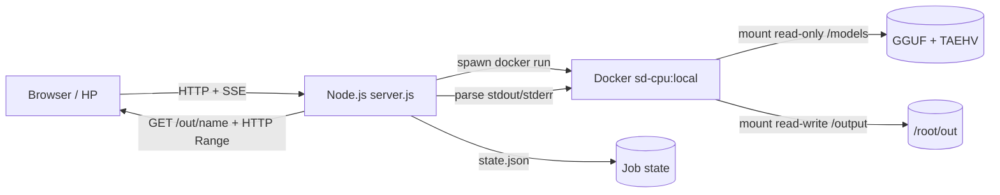

# sd-wan-ui

UI web ringan untuk menjalankan inference **Wan 2.1 T2V 1.3B Q4_K_M** lewat `stable-diffusion.cpp` di Docker, dengan progres realtime via Server-Sent Events (SSE) dan gallery hasil.

## Ringkasan

- Backend: **Node.js built-in modules only** (`http`, `fs`, `path`, `child_process`) — tidak ada dependency npm.
- Inference: `sd-cli` dari `stable-diffusion.cpp` release `master-1106-532d2c1`, dikemas sebagai image Docker CPU `sd-cpu:local`.
- Target awal: server tanpa GPU, 2 core CPU, RAM 7.8 GB, disk awal 4.4 GB.
- Mode: `-M vid_gen`. `frames=1` menghasilkan PNG; `frames>1` menghasilkan video.
- UI: vanilla HTML/CSS/JS, responsive Apple-like, dilengkapi filter Semua/Gambar/Video.

## Arsitektur



### Alur request

1. Browser membuka `/` dan langsung membuka `/api/stream`.
2. Server mengirim event `hello` berisi `job` terakhir dan daftar `files`.
3. Browser POST ke `/api/generate` dengan `prompt`, `frames`, `steps`, `width`, `height`, `cfg`, dan `negative`.
4. Server memvalidasi input, lalu membuat satu job dan menjalankan Docker:
   - `-M vid_gen`
   - `--diffusion-model /models/wan2.1_t2v_1.3b-q4_k_m.gguf`
   - `--t5xxl /models/umt5-xxl-encoder-Q3_K_S.gguf`
   - `--taesd /models/taew2_1.safetensors`
   - `-o /output/<nama>`
5. Stdout/stderr `sd-cli` diparse untuk:
   - progress `current/total/percent`
   - log penting `[I]`, `[W]`, `[E]`
   - path hasil dari baris `save result ...`
6. Server menyebarkan event SSE: `status`, `progress`, `log`, `files`, `file`.
7. File watcher 1 detik mendeteksi file baru di `/root/out`, lalu gallery di-refresh.
8. Video dilayani lewat `/out/<nama>` dengan dukungan `HTTP 206 Partial Content` sehingga bisa di-seek di browser/HP.

### Komponen

| File | Fungsi |
| --- | --- |
| `server.js` | HTTP router, SSE hub, job manager, auth opsional, state persistence, video Range serving |
| `index.html` | UI single-file: form generate, status/progress, log, gallery, filter media |
| `Dockerfile` | Image CPU dari binary resmi `stable-diffusion.cpp` Ubuntu 26.04 x86_64 |
| `scripts/download-models.sh` | Download model ke `MODEL_DIR` |
| `scripts/build-image.sh` | Build image `sd-cpu:local` |
| `scripts/infer.sh` | Inference manual tanpa UI |
| `scripts/start-ui.sh` | Menjalankan UI dengan `.env` opsional |
| `.env.example` | Contoh konfigurasi lingkungan |
| `state.json` | Disimpan otomatis saat runtime; tidak ikut di-commit |

## Model

| Komponen | File | Alasan |
| --- | --- | --- |
| Diffusion | `wan2.1_t2v_1.3b-q4_k_m.gguf` | Sesuai permintaan: Wan 1.3B Q4_K_M |
| Text encoder | `umt5-xxl-encoder-Q3_K_S.gguf` | Q8 tidak muat; Q3_K_S tetap near-original dengan ukuran lebih kecil |
| VAE | `taew2_1.safetensors` | TAEHV kecil dipakai sebagai pengganti VAE penuh agar hemat disk |

Total parameter memori yang dilaporkan `sd-cli`: sekitar **3.7 GB RAM**, dengan compute buffer tambahan saat decoding.

Sumber model:

- `https://huggingface.co/calcuis/wan-1.3b-gguf/resolve/main/wan2.1_t2v_1.3b-q4_k_m.gguf`
- `https://huggingface.co/city96/umt5-xxl-encoder-gguf/resolve/main/umt5-xxl-encoder-Q3_K_S.gguf`
- `https://github.com/madebyollin/taehv/raw/refs/heads/main/safetensors/taew2_1.safetensors`

## API

| Method | Endpoint | Keterangan |
| --- | --- | --- |
| `GET` | `/` | UI |
| `GET` | `/api/health` | Health check ringan, tidak terkena auth |
| `GET` | `/api/status` | Job terakhir + daftar file |
| `GET` | `/api/files` | Daftar file hasil |
| `GET` | `/api/stream` | SSE realtime |
| `POST` | `/api/generate` | Memulai inference |
| `GET` | `/out/<nama>` | Mengirim PNG/MP4/WebM/AVI, support Range |

Contoh generate video pendek:

```bash
curl -X POST http://127.0.0.1:3001/api/generate \
  -H 'Content-Type: application/json' \
  -d '{
    "prompt": "a lovely cat walking in neon rain, cinematic lighting",
    "frames": 9,
    "steps": 4,
    "width": 320,
    "height": 256,
    "cfg": 6
  }'
```

Event SSE:

- `hello` — state awal
- `status` — perubahan status job
- `progress` — progres sampling
- `log` — baris log terpilih
- `files` — daftar file terbaru
- `file` — notifikasi file baru

## Konfigurasi

Salin `.env.example` menjadi `.env`, lalu sesuaikan:

| Variabel | Default | Keterangan |
| --- | --- | --- |
| `HOST` | `0.0.0.0` | Bind address UI |
| `PORT` | `3001` | Port UI |
| `UI_TOKEN` | kosong | Jika diisi, aktifkan Basic Auth dengan username `sd` |
| `OUT_DIR` | `/root/out` | Direktori hasil generate |
| `MODEL_DIR` | `/root/models/wan` | Direktori model GGUF/TAEHV |
| `SD_IMAGE` | `sd-cpu:local` | Nama image Docker inference |

Jika `UI_TOKEN` kosong, UI terbuka tanpa auth. Untuk deployment publik, disarankan mengisinya dan menaruh reverse proxy dengan TLS di depan.

## Menjalankan

```bash
./scripts/download-models.sh
./scripts/build-image.sh
cp .env.example .env
./scripts/start-ui.sh
```

Buka `http://<host>:3001`.

Inference manual tanpa UI:

```bash
FRAMES=9 STEPS=4 WIDTH=320 HEIGHT=256 ./scripts/infer.sh "a lovely cat walking in neon rain"
```

## Catatan video

Build `stable-diffusion.cpp` ini menyimpan hasil multi-frame sebagai AVI Motion JPEG meskipun nama output diakhiri `.mp4`, misalnya `wan-123.mp4.avi`. UI sudah mengenali `.avi`, tetapi untuk kompatibilitas browser yang lebih luas hasil bisa dikonversi:

```bash
ffmpeg -y -i /root/out/wan-123.mp4.avi \
  -c:v libx264 -pix_fmt yuv420p -movflags +faststart \
  /root/out/wan-123.mp4
```

Pada host uji, 9 frame `320x256` dengan 4 step memakan waktu sekitar **113 detik** di 2 core CPU.

## Keamanan dan produksi

- Basic Auth opsional lewat `UI_TOKEN` (`username: sd`).
- Rate limit: 10 request `/api/generate` per menit per IP.
- Hanya satu inference aktif pada satu waktu; request lain mendapat `409`.
- Security headers: `nosniff`, `X-Frame-Options: DENY`, `Referrer-Policy`, dan CSP.
- Job state bertahan di `state.json`; job yang sedang berjalan saat server restart ditandai error.
- `OUT_DIR`, model, log, PID, `.env`, dan `state.json` tidak ikut di-commit.
- Belum ada TLS bawaan; gunakan Nginx/Caddy/Cloudflare Tunnel untuk HTTPS.

## Struktur direktori

```text
sd-wan-ui/
├── Dockerfile
├── README.md
├── .env.example
├── .gitignore
├── index.html
├── server.js
└── scripts/
    ├── build-image.sh
    ├── download-models.sh
    ├── infer.sh
    └── start-ui.sh
```
