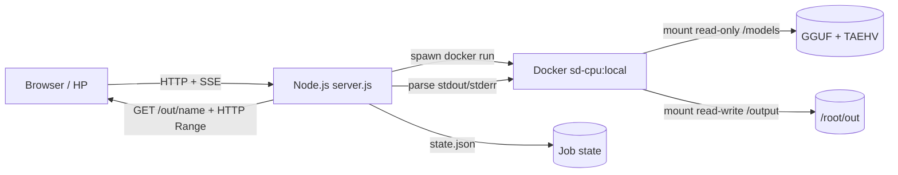

# sd-wan-ui

UI web ringan untuk menjalankan inference **Wan 2.1 T2V 1.3B Q4_K_M** lewat `stable-diffusion.cpp` di Docker, dengan progres realtime via Server-Sent Events (SSE) dan gallery hasil.

## Ringkasan

- Backend: **Node.js built-in modules only** (`http`, `fs`, `path`, `child_process`) — tidak ada dependency npm.
- Inference: `sd-cli` dari `stable-diffusion.cpp` release `master-1106-532d2c1`, dikemas sebagai image Docker CPU `sd-cpu:local`.
- Target awal: server tanpa GPU, 2 core CPU, RAM 7.8 GB, disk awal 4.4 GB.
- Mode: `-M vid_gen`. `frames=1` menghasilkan PNG; `frames>1` menghasilkan video.
- UI: vanilla HTML/CSS/JS, responsive Apple-like, dilengkapi filter Semua/Gambar/Video.

## Spesifikasi & benchmark VPS

Diukur 2026-11-21 pada host yang menjalankan UI ini.

| Item | Nilai |
| --- | --- |
| OS | Ubuntu 24.04.4 LTS (Noble Numbat) |
| Kernel | Linux 6.8.0-147-generic |
| Virtualisasi | KVM full, BIOS QEMU `pc-i440fx-11.0` |
| CPU | AMD EPYC 9355P 32-Core Processor, **2 vCPU** tersedia |
| Arsitektur | x86_64, 1 socket, 2 core, 1 thread/core |
| CPU flags | AVX2, AVX-512, FMA, BMI2, SHA-NI, AES-NI |
| Cache | L1d 128 KiB x2, L1i 128 KiB x2, L2 1 MiB x2, L3 32 MiB |
| BogoMIPS | 7089.34 |
| RAM | 7.8 GiB total; 6.1 GiB terpakai; 1.7 GiB available saat inference |
| Swap | 2.0 GiB total; 1.1 GiB terpakai saat inference |
| Disk | 96 G total; 261 M free; 100% terpakai |
| Penggunaan disk | model 3.7 G, `/root/out` ~1 M, repo 604 K |
| Docker | 29.9.2 |
| GPU | Tidak ada; tidak ada CUDA/Vulkan |

### Benchmark inference nyata

Angka ini berasal dari log `sd-cli`, bukan benchmark sintetis.

| Konfigurasi | Hasil |
| --- | --- |
| 9 frame, 320x256, 4 step | `generate_video completed in 112.79s` |
| 5 frame, 320x256, 2 step | `generate_video completed in 67.85s` |
| 29 frame, 512x320, 20 step | Rata-rata **113.89 detik/step** pada 19 step teramati; min 95.55s, max 148.71s |
| Beban model | 3727.48 MB weight; T5 compute buffer 297 MB; Wan compute buffer 249.25 MB |

### Berapa lama tambah 1 step?

`steps` adalah jumlah iterasi denoising. Total waktu kira-kira:

```text
total ≈ overhead model + T5 + decode + (steps × detik/step)
```

Overhead tetap di host ini sekitar 40–50 detik: load model ±7 detik, T5 conditioning ±35.7 detik, decode TAEHV ±10 detik. Jadi menambah `1 step` hanya menambah biaya satu iterasi, bukan mengulang seluruh overhead.

| Konfigurasi | Tambah 1 step |
| --- | --- |
| 5 frame, 320x256 | ±14–16 detik |
| 9 frame, 320x256 | ±16–20 detik |
| 29 frame, 512x320 | ±96–149 detik, rata-rata ±114 detik |
| 161 frame, 512x320 | estimasi kasar ±10–12 menit per step |

Contoh: menaikkan `steps` dari 20 ke 21 pada job 29 frame/512x320 menambah sekitar **114 detik**. Total 20 step ≈38 menit, 21 step ≈40 menit. Estimasi 161 frame dihitung linear dari 29 frame dan belum diuji langsung.

CPU AMD EPYC 9355P terlihat modern dan mendukung AVX-512, tetapi hanya 2 vCPU yang dilewatkan ke VM dan tidak ada GPU. Swap mulai terpakai saat inference video 512x320/20 step, jadi jangan menjalankan dua job bersamaan. Disk juga kritikal, lakukan cleanup sebelum preset 25 detik ke atas.

### Proses CPU vs GPU

Versi `sd-cli` bisa tetap `master-1106-532d2c1`; yang berbeda adalah build/image backend dan device yang dipakai. Alur inference tetap sama, hanya lokasi weight dan komputasi yang berpindah.

| Tahap | CPU — default sekarang | GPU — setelah image + driver siap |
| --- | --- | --- |
| Docker flag | `--backend cpu`, tanpa flag GPU | `--gpus all --backend cuda0` atau `--device /dev/dri --backend vulkan0` |
| Backend | `libggml-cpu-zen4.so`, 2 thread | CUDA/Vulkan backend, paralelisme jauh lebih besar |
| Weight | RAM ±3.7 GB | VRAM; `auto-fit` offload ke RAM/disk jika VRAM kurang |
| T5 encode prompt + negative | ±35.7 detik terukur | ±2–8 detik estimasi |
| Denoise 29 frame, 512x320, 1 step | ±114 detik terukur | ±1–4 detik estimasi |
| TAEHV decode | ±10 detik terukur | ±1–3 detik estimasi |
| AVI → MP4 via `ffmpeg` | Sama, berjalan di host | Sama, kecuali encoder GPU diatur terpisah |

Contoh job 29 frame/512x320/20 step: CPU sekitar **38 menit**, GPU kelas 8–12 GB sekitar **1–3 menit**. Angka GPU belum diukur di VPS ini karena GPU belum tersedia, jadi hanya estimasi. Jika VRAM kurang dari 8 GB dan `auto-fit` mulai offload ke RAM, kecepatan bisa turun drastis mendekati CPU.

### Docker exit 137 / OOM

Exit code `137` berarti proses di-`SIGKILL`. Pada job 29 frame/512x320/20 step, kernel mencatat `oom-kill: task=sd-cli` dan `Out of memory: Killed process ... anon-rss:6133828kB`. Sampling sempat selesai `20/20` dalam 2296 detik, lalu proses mati saat `decode_video_outputs`/TAEHV decode. Jadi ini kehabisan RAM + swap, bukan file video rusak.

Penanganan:

1. Turunkan beban ke `320x256`, `frames <= 9`, dan `steps = 4–10` — konfigurasi ini sudah terbukti sukses.
2. Jangan jalankan dua job bersamaan; hentikan container/service lain yang tidak dipakai.
3. Tambah RAM atau swap. Swap 2 GB saat ini sudah terpakai ±1 GB, jadi kosongkan disk dulu sebelum menambah swap.
4. Untuk preset 25–60 detik, pakai VPS minimal 16 GB RAM atau GPU.

Cek cepat:

```bash
dmesg -T | grep -i 'killed process'
docker inspect <container> --format '{{.State.OOMKilled}}'
free -h
```

Untuk mengecek ulang:

```bash
lscpu
free -h
df -h /
docker version --format '{{.Server.Version}}'
curl -s http://127.0.0.1:3001/api/status
```

## Arsitektur



### Alur request

1. Browser membuka `/` dan langsung membuka `/api/stream`.
2. Server mengirim event `hello` berisi `job` terakhir dan daftar `files`.
3. Browser POST ke `/api/generate` dengan `prompt`, `frames`, `steps`, `width`, `height`, `cfg`, dan `negative`.
4. Server memvalidasi input, lalu membuat satu job dan menjalankan Docker:
   - `-M vid_gen`
   - `--diffusion-model /models/wan2.1_t2v_1.3b-q4_k_m.gguf`
   - `--t5xxl /models/umt5-xxl-encoder-Q3_K_S.gguf`
   - `--taesd /models/taew2_1.safetensors`
   - `-o /output/<nama>`
5. Stdout/stderr `sd-cli` diparse untuk:
   - progress `current/total/percent`
   - log penting `[I]`, `[W]`, `[E]`
   - path hasil dari baris `save result ...`
6. Server menyebarkan event SSE: `status`, `progress`, `log`, `files`, `file`.
7. File watcher 1 detik mendeteksi file baru di `/root/out`, lalu gallery di-refresh.
8. Video dilayani lewat `/out/<nama>` dengan dukungan `HTTP 206 Partial Content` sehingga bisa di-seek di browser/HP.

### Komponen

| File | Fungsi |
| --- | --- |
| `server.js` | HTTP router, SSE hub, job manager, auth opsional, state persistence, video Range serving |
| `index.html` | UI single-file: form generate, status/progress, log, gallery, filter media |
| `Dockerfile` | Image CPU dari binary resmi `stable-diffusion.cpp` Ubuntu 26.04 x86_64 |
| `scripts/download-models.sh` | Download model ke `MODEL_DIR` |
| `scripts/build-image.sh` | Build image `sd-cpu:local` |
| `scripts/infer.sh` | Inference manual tanpa UI |
| `scripts/start-ui.sh` | Menjalankan UI dengan `.env` opsional |
| `.env.example` | Contoh konfigurasi lingkungan |
| `state.json` | Disimpan otomatis saat runtime; tidak ikut di-commit |

## Detail model

Pipeline Wan T2V memakai tiga model yang dipanggil berurutan oleh `sd-cli`:

| Tahap | File | Ukuran | Fungsi | Kenapa dipilih |
| --- | --- | --- | --- | --- |
| Text conditioning | `umt5-xxl-encoder-Q3_K_S.gguf` | 2.7 GB | Mengubah prompt positif dan negatif jadi embedding teks | UMT5-XXL adalah encoder teks yang diharapkan Wan. Q8 tidak muat di disk/RAM host uji, jadi dipakai Q3_K_S yang jauh lebih kecil dengan kualitas masih memadai untuk prompt pendek |
| Diffusion / denoising | `wan2.1_t2v_1.3b-q4_k_m.gguf` | 987 MB | Model Wan 2.1 T2V 1.3B yang membuat latent video dari embedding teks | Sesuai permintaan. Q4_K_M adalah titik seimbang antara ukuran dan akurasi, serta muat di RAM 7.8 GB |
| VAE decode | `taew2_1.safetensors` | 22 MB | Mendekode latent video menjadi frame akhir | VAE Wan penuh jauh lebih besar. TAEHV membuat total model hanya ~3.7 GB dan decoding jauh lebih ringan di CPU |

Total file model di disk: **~3.7 GB**. `sd-cli` juga melaporkan total parameter memori ~3.7 GB ditambah compute buffer saat conditioning dan decoding.

Tahap internal yang terlihat di log runtime:

1. `load_backend` memilih backend `ggml-cpu` karena auto-fit mendeteksi `no GPU devices`.
2. `get_learned_condition` menjalankan UMT5 untuk prompt positif dan negatif.
3. `generate_video` menjalankan sampling FLOW/Euler pada diffusion model selama `--steps` langkah.
4. `decode_video_outputs` memanggil TAEHV mengubah latent `40x32x3x16` menjadi `320x256x9x3`.
5. `save result` menulis hasil ke `/output`, lalu Node menyalin daftar file ke UI.

Sumber model:

- `https://huggingface.co/calcuis/wan-1.3b-gguf/resolve/main/wan2.1_t2v_1.3b-q4_k_m.gguf`
- `https://huggingface.co/city96/umt5-xxl-encoder-gguf/resolve/main/umt5-xxl-encoder-Q3_K_S.gguf`
- `https://github.com/madebyollin/taehv/raw/refs/heads/main/safetensors/taew2_1.safetensors`

## Fungsi `stable-diffusion.cpp` yang dipakai

Semua argumen dirakit di `startJob()` (`server.js:223`). Berikut arti dan alasannya:

| Argumen | Fungsi | Kenapa |
| --- | --- | --- |
| `-M vid_gen` | Mengaktifkan mode video generation Wan | Tanpa ini, `--video-frames` saja tidak cukup untuk menghasilkan video |
| `--diffusion-model ...q4_k_m.gguf` | Memuat checkpoint diffusion utama | Mesin denoising Wan 1.3B; Q4_K_M sesuai target ukuran/akurasi |
| `--t5xxl ...Q3_K_S.gguf` | Memuat text encoder UMT5-XXL | Wan memerlukan conditioning teks; Q3_K_S dipilih agar muat resource |
| `--taesd ...taew2_1.safetensors` | Memakai TAEHV sebagai VAE pengganti | Lebih ringan dari VAE penuh, cukup untuk preview video |
| `-p` / `-n` | Prompt positif dan negatif | Diolah oleh T5 sebelum masuk diffusion model |
| `--cfg-scale 6.0` | Mengontrol seberapa kuat prompt memandu sampling | 6.0 cukup mengarah tanpa efek berlebih pada Wan CPU |
| `--sampling-method euler` | Solver sampling FLOW | Cukup cepat dan stabil di CPU dibanding solver yang lebih kompleks |
| `--flow-shift 3.0` | Menyesuaikan jadwal noise FLOW | Nilai umum untuk Wan dan aman di step rendah |
| `--steps` | Jumlah langkah denoising | 4 untuk smoke test cepat, 10 untuk kualitas uji |
| `-W` / `-H` | Resolusi frame | 320x256 dipakai saat uji video agar 2 core CPU tidak kewalahan; server memaksa kelipatan 16 |
| `--video-frames` | Jumlah frame yang dibuat | `1` menghasilkan PNG, `>1` menghasilkan video |
| `-o /output/<nama>.avi` | Path output di dalam container | `/root/out` di-mount ke `/output`. Harus `.avi`/`.webm`/`.webp`; `.mp4` akan ditambahi `.avi` oleh `sd-cli` |
| `-v` | Logging verbose | Server mem-parsing progres dan path hasil dari baris log verbose |

Backend dipilih otomatis sebagai CPU. Tidak ada flag CUDA/Vulkan karena host tidak memiliki GPU dan image resmi CPU yang dipakai adalah build Ubuntu x86_64 biasa.

Untuk video, server meminta `.avi` ke `sd-cli`, lalu setelah container selesai menjalankan `ffmpeg` untuk menghasilkan `.mp4` H.264/yuv420p yang bisa diputar browser. AVI asli dihapus kecuali `KEEP_AVI=1`. Jika `ffmpeg` tidak tersedia, AVI tetap disimpan dan UI menampilkan warning.

## Mode generate: Gambar / Video

UI menyediakan toggle **Gambar** / **Video** di bagian atas form. Default adalah **Gambar**.

- **Gambar**: `frames` dikunci ke `1`, selector durasi disembunyikan, dan tombol berubah menjadi **Generate Gambar**. Preset kualitas tetap dipakai untuk mengisi `steps`, `cfg`, `width`, dan `height`.
- **Video**: selector durasi aktif, minimal `frames` menjadi `2`, dan tombol berubah menjadi **Generate Video**. Jika `frames` masih `1` saat berpindah ke mode video, nilai diisi `9` sebagai default cepat.

Toggle ini hanya mengubah UI dan payload yang dikirim; backend tetap menentukan gambar/video dari nilai `frames`.

## Menghentikan job

Saat ada inference aktif, tombol **Stop** muncul di sebelah status job. Tombol ini memanggil `POST /api/cancel`, menghentikan container Docker terkait, lalu menandai job sebagai `stopped`.

Job yang dihentikan tidak menjalankan transcode dan tidak menyimpan output akhir. File yang sudah ditulis sebelum stop tetap muncul di galeri. Lewat SSE, perubahan status langsung terkirim ke UI tanpa refresh.

## Galeri hasil

Galeri memuat hasil **per halaman** (12 item) lewat `GET /api/files?page=N&limit=12&type=all|image|video`; SSE hanya mengirim jumlah file, bukan seluruh daftar. Filter Gambar/Video dan tombol Prev/Next memicu request baru, sehingga daftar besar tidak dikirim sekaligus.

Klik thumbnail untuk membuka lightbox; navigasi ←/→ dan tombol Prev/Next di lightbox berjalan di dalam halaman aktif. Tombol download memakai `?download=1` agar server mengirim `Content-Disposition: attachment`. Tombol hapus memanggil `POST /api/delete` dengan `{ "name": "..." }`; untuk MP4/AVI, varian pasangannya ikut dihapus. File yang sedang dipakai job aktif tidak bisa dihapus.

Grid memakai `auto-fill` responsif: otomatis 1 kolom di layar sempit, 2–3 kolom di mobile/tablet, dan lebih banyak di desktop.

## Preset durasi dan kualitas video

Saat mode **Video** aktif, UI menyediakan dua selector, **Durasi video** dan **Kualitas**. **Durasi** mengisi `frames`; **Kualitas** mengisi `steps`, `cfg`, `width`, dan `height`. Nilai tetap bisa diedit manual setelah preset dipilih. Preset **Kualitas** juga bisa dipakai di mode **Gambar** untuk mengisi `steps`/resolusi tanpa mengubah `frames=1`.

Presets berasal dari server lewat `GET /api/presets`, sehingga daftar dan batas frame selalu sinkron dengan backend.

Wan berjalan pada 16 fps dengan alignment `4n+1`, maka durasi dibulatkan ke frame terdekat:

| Durasi | Frame | Durasi aktual |
| --- | --- | --- |
| 10 detik | 161 | ≈10.063 detik |
| 15 detik | 241 | ≈15.063 detik |
| 25 detik | 401 | ≈25.063 detik |
| 30 detik | 481 | ≈30.063 detik |
| 60 detik | 961 | ≈60.063 detik |

| Kualitas | Steps | Resolusi | CFG | Catatan |
| --- | --- | --- | --- | --- |
| Low | 4 | 320x256 | 6 | Coba cepat, cocok untuk pengujian |
| Medium | 10 | 512x320 | 6 | Seimbang; 29 frame/20 step saat ini memakan ±100 detik per step di host 2 core |
| High | 20 | 640x400 | 6 | Lebih rapi, jauh lebih lama dan lebih boros RAM |

Sampler tetap `euler` dan negative prompt tidak ditimpa preset. Pilihan 25 detik ke atas menampilkan peringatan dan konfirmasi karena berisiko sangat lama pada CPU 2 core/RAM 7.8GiB. Batas frame server dinaikkan menjadi `961`, tetapi tidak ada jaminan performa untuk 60 detik pada host tanpa GPU.

## Generate gambar (`frames=1`)

Aplikasi tetap memakai mode Wan `-M vid_gen`, tetapi **`frames=1` menghasilkan satu file PNG**. Tidak ada AVI maupun ffmpeg untuk mode ini; hasil langsung muncul di filter **Gambar** dengan nama `wan-<timestamp>-<n>.png`.

### Arti config saat generate gambar

| Field UI | Argumen `sd-cli` | Default | Rekomendasi | Penjelasan |
| --- | --- | --- | --- | --- |
| Prompt | `-p` | `a lovely cat walking in neon rain...` | Deskripsikan subjek, gaya, pencahayaan, dan komposisi | Diolah UMT5-XXL menjadi conditioning positif |
| Frames | `--video-frames 1` | `1` | **Wajib `1`** | `1` → PNG. Nilai `>1` berubah jadi video dan tidak dipakai untuk generate gambar |
| Steps | `--steps` | `10` | `4` cepat, `10` seimbang, `20–30` final | Jumlah iterasi denoising. Tidak mengubah ukuran gambar; makin banyak makin rapi tapi makin lama. Di 2 core CPU, `512x320` / 10 step memakan ±2–3 menit |
| CFG | `--cfg-scale` | `6.0` | `5–7` | Seberapa kuat prompt memandu hasil. CFG juga memperkuat negative prompt. Terlalu tinggi bisa over-saturasi/artefak; terlalu rendah membuat prompt terabaikan |
| Negative | `-n` | `blurry, low quality, watermark, text` | Tambah `jpeg artifacts, flicker, deformed` bila perlu | Daftar hal yang ingin dihindari, bukan filter setelah jadi. Jangan memasukkan elemen yang memang diinginkan |
| Sampler | `--sampling-method euler` | `euler` | `euler` | Solver default Wan untuk FLOW; cepat dan stabil di CPU. Field di UI sengaja disabled karena server meng-hardcode nilai ini |
| Flow shift | `--flow-shift 3.0` | `3.0` | Biarkan | Menyesuaikan jadwal noise FLOW. Umumnya tidak perlu diubah |
| Width / Height | `-W` / `-H` | `512 x 320` | `320x256` cepat, `512x320` seimbang | Server memaksa kelipatan 16. Resolusi lebih tinggi menambah waktu dan RAM |
| Seed | `-s` | belum diekspos | — | Saat ini memakai perilaku default `sd-cli`; belum bisa diatur dari UI |

### Langkah di UI

1. Pastikan toggle berada di **Gambar**; `frames` otomatis terkunci ke `1`.
2. Isi **Prompt**.
3. Pilih **Kualitas** (`Low` untuk cepat, `Medium` untuk seimbang).
4. Buka **Pengaturan lanjutan**, atur **Negative prompt** bila perlu.
5. Klik **Generate Gambar**. Progres tetap muncul lewat SSE seperti mode video.
6. File PNG muncul di gallery pada filter **Gambar**.

### Contoh via API

```bash
curl -X POST http://127.0.0.1:3001/api/generate \
  -H 'Content-Type: application/json' \
  -d '{
    "prompt": "portrait of a cat astronaut, cinematic lighting, detailed fur",
    "negative": "blurry, low quality, watermark, text, deformed",
    "frames": 1,
    "steps": 10,
    "cfg": 6,
    "width": 512,
    "height": 320
  }'
```

### Tips cepat

- Hasil terlalu lembek/curang detail → naikkan `steps` ke `20–30`.
- Prompt kurang diikuti → naikkan `cfg` ke `7–8` atau perjelas prompt.
- Warna terlalu "terbakar"/kontras → turunkan `cfg` ke `4–5`.
- CPU terlalu lambat → pakai `320x256` dan `steps=4`.
- Ingin variasi berbeda dengan prompt sama → ubah seed, tetapi opsi ini belum tersedia di UI saat ini.

## API

| Method | Endpoint | Keterangan |
| --- | --- | --- |
| `GET` | `/` | UI |
| `GET` | `/api/health` | Health check ringan, tidak terkena auth |
| `GET` | `/api/status` | Job terakhir + daftar file |
| `GET` | `/api/files` | Daftar file hasil |
| `GET` | `/api/presets` | Daftar preset durasi/kualitas video |
| `GET` | `/api/stream` | SSE realtime |
| `POST` | `/api/generate` | Memulai inference |
| `GET` | `/out/<nama>` | Mengirim PNG/MP4/WebM/AVI, support Range |

Contoh generate video pendek:

```bash
curl -X POST http://127.0.0.1:3001/api/generate \
  -H 'Content-Type: application/json' \
  -d '{
    "prompt": "a lovely cat walking in neon rain, cinematic lighting",
    "frames": 9,
    "steps": 4,
    "width": 320,
    "height": 256,
    "cfg": 6
  }'
```

Event SSE:

- `hello` — state awal
- `status` — perubahan status job
- `progress` — progres sampling
- `log` — baris log terpilih
- `files` — daftar file terbaru
- `file` — notifikasi file baru

## Konfigurasi

Salin `.env.example` menjadi `.env`, lalu sesuaikan:

| Variabel | Default | Keterangan |
| --- | --- | --- |
| `HOST` | `0.0.0.0` | Bind address UI |
| `PORT` | `3001` | Port UI |
| `UI_TOKEN` | kosong | Jika diisi, aktifkan Basic Auth dengan username `sd` |
| `OUT_DIR` | `/root/out` | Direktori hasil generate |
| `MODEL_DIR` | `/root/models/wan` | Direktori model GGUF/TAEHV |
| `SD_IMAGE` | `sd-cpu:local` | Nama image Docker inference |
| `SD_BACKEND` | `cpu` | Backend `sd-cli`: `cpu`, `cuda`/`cuda0`, `vulkan`/`vulkan0`, atau module map seperti `clip=cpu,diffusion=cuda0` |
| `GPU_DEVICES` | `all` | Nilai `--gpus` Docker saat backend CUDA |
| `VULKAN_DEVICE` | `/dev/dri` | Device Docker saat backend Vulkan/AMD/Intel |
| `SD_EXTRA_ARGS` | kosong | Argumen CLI tambahan, misalnya `--max-vram 8` |
| `FFMPEG_BIN` | `ffmpeg` | Path binary ffmpeg untuk konversi AVI → MP4 |
| `KEEP_AVI` | `0` | Set `1` untuk menyimpan AVI asli setelah konversi |

Jika `UI_TOKEN` kosong, UI terbuka tanpa auth. Untuk deployment publik, disarankan mengisinya dan menaruh reverse proxy dengan TLS di depan.

### Backend inference

Default `SD_BACKEND=cpu`, sehingga tidak ada flag GPU Docker yang ditambahkan. Nilai yang didukung:

| `SD_BACKEND` | Docker flag | `sd-cli` flag |
| --- | --- | --- |
| `cpu` | — | `--backend cpu` |
| `cuda` / `cuda0` | `--gpus all` | `--backend cuda0` |
| `vulkan` / `vulkan0` | `--device /dev/dri` | `--backend vulkan0` |
| `clip=cpu,diffusion=cuda0` | `--gpus all` | diteruskan apa adanya |

`GPU_DEVICES` mengubah nilai `--gpus` untuk NVIDIA, sedangkan `VULKAN_DEVICE` mengubah path device untuk AMD/Intel Vulkan. `SD_EXTRA_ARGS` diteruskan sebagai argumen CLI tanpa shell, sehingga aman untuk nilai seperti `--max-vram 8`.

Untuk memakai GPU nanti: siapkan image CUDA/Vulkan, set `SD_IMAGE=sd-gpu:local`, lalu set `SD_BACKEND=cuda0` atau `vulkan0`. Server tidak mendeteksi GPU secara otomatis; backend harus dipilih lewat env. Detail backend aktif bisa dilihat di `GET /api/health`.

## Deployment

### Development / akses langsung

```bash
./scripts/download-models.sh
./scripts/build-image.sh
cp .env.example .env
./scripts/start-ui.sh
```

Buka `http://<host>:3001`. Mode ini cocok untuk pengujian lokal. Jika UI diekspos langsung ke internet, **wajib** isi `UI_TOKEN` karena tanpa reverse proxy tidak ada TLS.

Inference manual tanpa UI:

```bash
FRAMES=9 STEPS=4 WIDTH=320 HEIGHT=256 ./scripts/infer.sh "a lovely cat walking in neon rain"
```

### Production dengan systemd + reverse proxy TLS

1. Isi `/root/sd-ui/.env`:

```env
HOST=127.0.0.1
PORT=3001
UI_TOKEN=ganti-dengan-token-kuat
OUT_DIR=/root/out
MODEL_DIR=/root/models/wan
SD_IMAGE=sd-cpu:local
FFMPEG_BIN=ffmpeg
KEEP_AVI=0
```

`HOST=127.0.0.1` disarankan bila reverse proxy berada di host yang sama. Jika tetap memakai `0.0.0.0`, batasi akses lewat firewall dan aktifkan `UI_TOKEN`.

2. Buat `/etc/systemd/system/sd-wan-ui.service`:

```ini
[Unit]
Description=sd-wan-ui
After=docker.service
Requires=docker.service

[Service]
Type=simple
WorkingDirectory=/root/sd-ui
EnvironmentFile=/root/sd-ui/.env
ExecStart=/usr/bin/node /root/sd-ui/server.js
Restart=always
RestartSec=3
User=root

[Install]
WantedBy=multi-user.target
```

`User=root` dipakai karena proses harus mengakses Docker socket. Jika memakai user non-root, pastikan user tersebut masuk grup `docker` (catatan: akses Docker setara root).

3. Aktifkan service:

```bash
systemctl daemon-reload
systemctl enable --now sd-wan-ui
journalctl -u sd-wan-ui -f
```

4. Pasang reverse proxy TLS. Contoh Caddy:

```caddyfile
sd.example.com {
    reverse_proxy 127.0.0.1:3001
}
```

Alternatif lain: Nginx + Let's Encrypt, Cloudflare Tunnel, atau Tailscale Funnel. Caddy sudah otomatis mengurus sertifikat HTTPS.

5. Verifikasi:

```bash
curl http://127.0.0.1:3001/api/health
curl -u sd:$UI_TOKEN http://127.0.0.1:3001/api/files
```

Tanpa auth, flag `-u` tidak diperlukan.

6. Update aplikasi:

```bash
cd /root/sd-ui
git pull
systemctl restart sd-wan-ui
```

`state.json` dan isi `OUT_DIR` tidak berubah saat restart.

### Kebutuhan resource

- Model: ~3.7 GB di disk.
- Image Docker + cache build: siapkan ruang tambahan beberapa GB.
- RAM: minimum ~7 GB untuk conditioning + diffusion + TAEHV.
- `ffmpeg`: diperlukan agar video AVI otomatis menjadi MP4 yang bisa diputar browser. Tanpa ini, hasil tetap AVI dan UI menampilkan warning.
- CPU: 2 core bisa, tapi 9 frame `320x256` / 4 step memakan ~113 detik.
- Host uji hanya memiliki sisa disk ~275 MB setelah instalasi, jadi lakukan cleanup atau tambah disk sebelum generate video panjang.

Contoh cleanup aman:

```bash
docker image prune -f
docker builder prune -f
rm -f /root/out/*.avi
```

## Kenapa video selalu `.avi` dan tidak bisa diputar

Ini perilaku `sd-cli` release `master-1106-532d2c1`, bukan bug di UI. Di `examples/cli/main.cpp`, fungsi `save_results()` hanya menerima `.avi`, `.webp`, dan `.webm` sebagai container video:

```cpp
if ((mode == VID_GEN && num_results > 1) || video_upscale_output) {
    if (ext_lower != ".avi" && ext_lower != ".webp" && ext_lower != ".webm")
        ext = ".avi";
    video_path = base_path;
    video_path += ext;
}
```

Karena `.mp4` tidak termasuk daftar itu, `-o wan-123.mp4` menjadi `wan-123.mp4.avi`. Isinya AVI Motion JPEG; Chrome dan Safari umumnya tidak bisa memutarnya, jadi terasa seperti video rusak. Jumlah 5 frame sendiri valid untuk Wan (`4n+1`), jadi bukan penyebab utamanya.

Perbaikan di repo ini:

- server meminta `-o wan-123.avi` agar tidak ada nama `.mp4.avi`;
- setelah container selesai, server menjalankan `ffmpeg` menjadi `wan-123.mp4` dengan `libx264`, `yuv420p`, dan `+faststart`;
- AVI asli dihapus otomatis kecuali `KEEP_AVI=1`;
- jika `ffmpeg` tidak tersedia, AVI tetap disimpan dan UI menampilkan warning.

Cek prerequisite di host:

```bash
ffmpeg -version
```

Konversi manual bila perlu:

```bash
ffmpeg -y -i /root/out/wan-123.avi \
  -c:v libx264 -pix_fmt yuv420p -movflags +faststart \
  /root/out/wan-123.mp4
```

Pada host uji, 9 frame `320x256` dengan 4 step memakan waktu sekitar **113 detik** di 2 core CPU.

## Keamanan dan produksi

- Basic Auth opsional lewat `UI_TOKEN` (`username: sd`).
- Rate limit: 10 request `/api/generate` per menit per IP.
- Hanya satu inference aktif pada satu waktu; request lain mendapat `409`.
- Security headers: `nosniff`, `X-Frame-Options: DENY`, `Referrer-Policy`, dan CSP.
- Job state bertahan di `state.json`; job yang sedang berjalan saat server restart ditandai error.
- `OUT_DIR`, model, log, PID, `.env`, dan `state.json` tidak ikut di-commit.
- Belum ada TLS bawaan; gunakan Nginx/Caddy/Cloudflare Tunnel untuk HTTPS dan sebaiknya bind `HOST=127.0.0.1` di belakang proxy.

## Struktur direktori

```text
sd-wan-ui/
├── Dockerfile
├── README.md
├── .env.example
├── .gitignore
├── index.html
├── server.js
└── scripts/
    ├── build-image.sh
    ├── download-models.sh
    ├── infer.sh
    └── start-ui.sh
```
